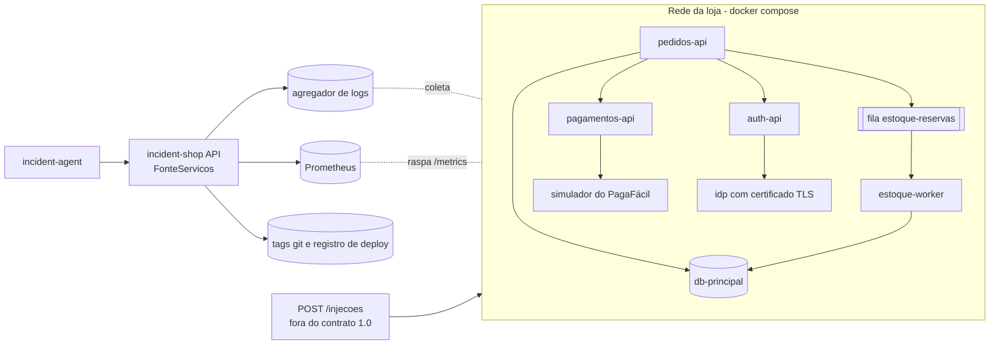

# Opção 2: serviços reais atrás da mesma API

Hoje a interface de programação de aplicações (API) do incident-shop responde com dados
simulados (`fonte: "simulada"`). A opção 2 troca só a origem dos dados: quatro serviços reais
rodam em contêineres, falhas são injetadas neles e a API lê logs, métricas e deploys do que
eles produzem. Esta entrega **não** implementa a opção 2; entra apenas o esqueleto
`api/fontes/servicos.py` (classe `FonteServicos`) e este desenho.

## Onde a troca acontece

As rotas dependem só da interface `FonteDados` (`api/fontes/__init__.py`). A variável de
ambiente `FONTE_DADOS` escolhe a implementação: `simulada` (padrão) ou `servicos`. Com
`servicos` hoje a API recusa subir, com `NotImplementedError` apontando para este documento.
Trocar a fonte não muda rotas, parâmetros nem campos: o contrato 1.1.0 continua valendo.

## Arquitetura



Componentes:

- Quatro serviços reais: `pedidos-api`, `pagamentos-api`, `estoque-worker` e `auth-api`.
- `db-principal` (banco de dados), fila `estoque-reservas`, simulador do PagaFácil (gateway
  externo de pagamento) e `idp` (provedor de identidade) com certificado de Transport Layer
  Security (TLS) que pode expirar.
- Coleta: agregador de logs (por exemplo Loki) e Prometheus.

## Esboço do docker compose (não salvo como arquivo)

```yaml
services:
  pedidos-api:
    build: ./pedidos-api
    environment: {DB_URL: "postgres://db-principal/loja", POOL_MAX: "20", PAGAMENTOS_URL: "http://pagamentos-api"}
    depends_on: [db-principal, fila, pagamentos-api]
  pagamentos-api:
    build: ./pagamentos-api
    environment: {GATEWAY_URL: "http://paga-facil-simulador:8080"}
  estoque-worker:
    build: ./estoque-worker
    environment: {ESTOQUE_QUEUE_URL: "amqp://fila/estoque-reservas"}
  auth-api:
    build: ./auth-api
    environment: {IDP_URL: "https://idp.loja.internal"}
  db-principal: {image: "postgres:16"}
  fila: {image: "rabbitmq:3"}
  paga-facil-simulador: {build: ./simuladores/paga-facil}   # responde 200, 429 ou 503 sob comando
  idp: {build: ./simuladores/idp}                           # certificado TLS com validade configurável
  loki: {image: "grafana/loki"}
  prometheus: {image: "prom/prometheus"}
  incident-shop:
    build: .
    environment: {FONTE_DADOS: "servicos", LOKI_URL: "http://loki:3100", PROMETHEUS_URL: "http://prometheus:9090"}
    ports: ["8000:8000"]
```

## Coleta de logs, métricas e deploys

| Dado | Origem na opção 2 | Como vira o contrato |
|---|---|---|
| Logs | Loki (consulta por rótulo `servico` e intervalo) ou arquivo JSON de log de cada contêiner | `RegistroLog`: horário, serviço, nível, mensagem; filtros e `limite` aplicados pela fonte |
| Métricas | Prometheus, consulta de intervalo com passo de 60 s | `SerieMetrica`: um ponto por minuto, unidade do contrato e resumo calculado |
| Deploys | Tags git do repositório e registro de deploy do ambiente | `Deploy`: tag, versão, commit, autor, mensagem e horário de entrada em produção |
| Cenários | Catálogo de injeção (id, título, serviço, sintoma, janela) | `CenarioPublico`, sem causa raiz |

## Injeção de falha: `POST /injecoes` (fora do contrato 1.0)

A rota de injeção é uma **adição futura** e não faz parte do contrato 1.1.0, que é só de
leitura. Ela existiria apenas na opção 2 (acréscimo compatível: sobe o contrato para 1.1.0) e
ficaria protegida, pois muda estado. Corpo previsto: `{"cenario": "<id>"}`. Cada cenário
vira uma ação sobre os contêineres, e a janela do cenário passa a ser o intervalo real em que
a falha ficou ativa:

| Cenário | Como seria injetado |
|---|---|
| `pool_esgotado` | Subir `pedidos-api` com `POOL_MAX=10` e aplicar carga de pico |
| `banco_lento_com_deploy` | Reindexar tabelas no `db-principal` e, perto disso, publicar um deploy inofensivo de `pedidos-api` |
| `deploy_com_bug` | Publicar a versão de `pagamentos-api` com desconto de cupom sem checar `null` e enviar pagamentos sem cupom |
| `env_var_faltando` | Subir `estoque-worker` sem `ESTOQUE_QUEUE_URL` |
| `certificado_expirado` | Trocar o certificado do `idp` por um expirado |
| `vazamento_memoria` | Publicar `auth-api` com cache de tokens sem limite e enviar validações até o contêiner ser encerrado por falta de memória |
| `gateway_fora` | Fazer o simulador do PagaFácil responder 503 por um período |
| `rate_limit` | Fazer o simulador do PagaFácil responder 429 acima de 100 requisições por minuto e gerar tráfego acima disso |

## Como manter o contrato e os testes

1. `FonteServicos` implementa os quatro métodos de `FonteDados` e converte tudo para os
   modelos de `api/modelos.py`; o OpenAPI não muda e `tests/test_contrato.py` continua passando.
2. Os testes de rota rodam contra qualquer fonte porque usam só o contrato. Os que dependem
   de valores exatos da simulação (por exemplo `waiting=41`) ficam restritos à fonte simulada;
   contra a fonte real valem testes de propriedade (formato, ordenação, janela, filtros, 404 e
   422), parametrizados por `FONTE_DADOS`.
3. Os testes trocam a fonte com `app.dependency_overrides[obter_fonte]` (ver
   `tests/test_fonte.py`), sem mudar rotas.
4. A gravação offline (`scripts/gravar_dados_dummy.py --url`) funciona igual contra a fonte
   real, mas a reprodutibilidade byte a byte só vale para a fonte simulada.
5. `/saude` informa `fonte: "servicos"`, para o agente saber de onde vêm os dados.

## Estatísticas do banco (`GET /estatisticas_banco`)

Na opção 2 o retrato do `db-principal` vem do próprio PostgreSQL, consultado pela
`FonteServicos.estatisticas_banco`:

- `pg_stat_user_tables`: `seq_scan` e `idx_scan` por tabela (as varreduras sequenciais e por
  índice; a API reporta a variação na última hora) e `last_analyze` (último `ANALYZE`).
- `pg_stat_progress_create_index`: indica se há `REINDEX` ou `CREATE INDEX` rodando na tabela
  (`reindexacao_em_andamento`).
- `pg_stat_activity`: o texto da instrução em andamento (`operacao_em_andamento`, por exemplo
  `REINDEX TABLE estoque`).
- Inchaço do índice: estimativa a partir do tamanho do índice (`pg_relation_size`) contra o
  tamanho esperado, ou da extensão `pgstattuple`.

Como o retrato é de um instante, o `momento` da consulta é o início do sintoma registrado no
catálogo de injeção.
